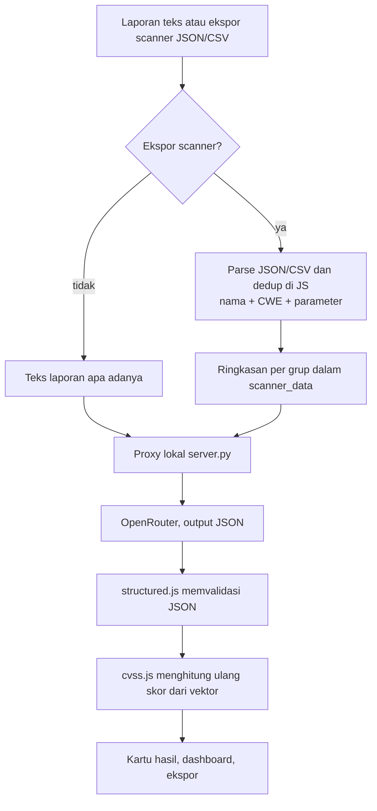

# VulnTriage

Agen triage laporan kerentanan keamanan. Menerima laporan bug hunter atau ekspor scanner (JSON/CSV), lalu menghasilkan klasifikasi, skor CVSS v3.1 yang diverifikasi ulang, pengelompokan duplikat, antrean prioritas, pemetaan regulasi Indonesia, dan draf tiket untuk developer.

Proyek capstone IBM Bob, IT Track (AI Agent).

VulnTriage **tidak memindai target dan tidak mengeksploitasi sistem apa pun**. Ia hanya menganalisis teks yang Anda masukkan.

---

## Masalah yang diselesaikan

Tim keamanan, program bug bounty, dan tim IT pemerintah atau UMKM sering menerima laporan yang:

1. **Tidak lengkap.** Pelapor mengirim satu baris tanpa endpoint, langkah reproduksi, atau bukti.
2. **Terlalu banyak dan berulang.** Satu scanner bisa menghasilkan puluhan temuan dengan akar masalah yang sama, misalnya header keamanan yang hilang di banyak URL.
3. **Sulit diprioritaskan.** Temuan kritis terkubur di antara temuan berisiko rendah.
4. **Sulit dijelaskan ke manajemen.** Laporan teknis berbahasa Inggris perlu diterjemahkan ke dampak bisnis dan konteks hukum, misalnya UU PDP No. 27/2022.

---

## Fitur

**Triage**
- **Pemeriksaan kelengkapan.** Jika 2 atau lebih elemen krusial hilang, agen tidak memberi skor dan hanya mengajukan maksimal 3 pertanyaan klarifikasi.
- **Klasifikasi** ke OWASP Top 10 2021 dan CWE.
- **Skor CVSS v3.1** dengan rasional per metrik. Skor dari LLM dihitung ulang di browser oleh `cvss.js` dari vektornya, sehingga angka tidak bergantung pada aritmetika model.
- **Skor false positive (0 sampai 100)** dengan alasan, termasuk untuk temuan yang hanya teoretis.
- **Langkah reproduksi tersanitasi.** Payload diganti placeholder seperti `<PAYLOAD>`.
- **Remediasi** jangka pendek dan panjang, plus contoh kode aman.

**Skala besar**
- **Dedup deterministik di JavaScript.** Ekspor scanner dikelompokkan berdasarkan nama + CWE + parameter sebelum dikirim ke LLM. LLM hanya menerima ringkasan per grup, sehingga ekspor besar tidak membengkakkan prompt.
- **Antrean prioritas:** Perbaiki Pertama, Perbaiki Segera, Backlog.
- **Scan Diff.** Membandingkan dua hasil scan menjadi Baru, Diperbaiki, dan Tidak Berubah. Kunci perbandingannya nama + URL + parameter, jadi temuan yang sama di URL berbeda tidak tercampur.

**Pelaporan**
- Pemetaan **UU PDP**, **ISO 27001:2022**, dan **OWASP ASVS** (bersifat indikatif).
- Ekspor: salin Markdown, unduh JSON, laporan HTML, dan format tiket siap tempel ke Jira atau GitHub Issues.
- Dashboard ringkasan severity.

**Mode kerja**
- **Live:** memanggil model lewat OpenRouter.
- **Mock:** respons contoh untuk demo tanpa API key.
- Editor system prompt di antarmuka untuk membandingkan variasi prompt.

---

## Cara kerja



Jika model tidak mengembalikan JSON yang valid, antarmuka memakai parser teks lama (`---TAG---`) sebagai cadangan.

---

## Menjalankan

Butuh Python 3 dan browser modern. Tidak ada dependensi yang perlu dipasang.

```bash
cd testforge
python server.py
```

Buka `http://127.0.0.1:8080`. Untuk port lain: `python server.py 9000`. Di Windows, jika `python` tidak dikenali, gunakan `py server.py`.

Server hanya bind ke `127.0.0.1`, jadi tidak bisa diakses dari perangkat lain di jaringan.

### Konfigurasi API key

Tanpa API key, aplikasi berjalan di **mock mode**. Untuk mode live, pilih salah satu:

1. Salin `.env.example` menjadi `.env`, lalu isi `OPENROUTER_API_KEY`. Variabel `OPENROUTER_MODEL` bersifat opsional dan menentukan model yang dicoba pertama.
2. Atau masukkan key lewat sidebar di antarmuka. Key ini dikirim ke proxy lokal dan tidak disimpan di server.

Jangan commit `.env`. Berkas itu sudah di luar pelacakan Git di repositori ini.

### Model

Aplikasi mengambil daftar model gratis OpenRouter yang sedang aktif, lalu mencoba satu per satu sampai ada yang berhasil. Model yang dipakai ditampilkan di antarmuka. Karena model gratis berbeda kemampuannya, mutu hasil bisa bervariasi antar model.

---

## Mencoba dengan sampel

Folder `samples/` berisi data uji:

| Berkas | Kegunaan |
|---|---|
| `01_sqli.md` | Laporan lengkap: SQL Injection pada form login |
| `02_stored_xss.md` | Laporan lengkap: Stored XSS pada kolom komentar |
| `03_idor.md` | Laporan lengkap: IDOR pada data profil nasabah |
| `04_incomplete.md` | Laporan satu baris, untuk menguji pertanyaan klarifikasi |
| `scanner_export_v1.json` | Ekspor ala OWASP ZAP, 6 temuan menjadi 4 grup |
| `scanner_export_v2.csv` | Ekspor ala Burp Suite, 9 temuan menjadi 6 grup |
| `checklist_*.md`, `samples_checklist.md` | Daftar mutu yang diharapkan untuk tiap sampel |

Uji Scan Diff: jalankan satu triage, buka Scan Diff, tempel `scanner_export_v1.json` di kolom lama dan `scanner_export_v2.csv` di kolom baru.

### Format ekspor scanner yang dikenali

- **JSON:** array, atau objek dengan kunci `findings`. Kolom yang dibaca: `id`, `name`, `risk` atau `severity`, `url`, `parameter`, `cwe`, `evidence`.
- **CSV:** baris pertama harus header. Kolom dipetakan dari nama header: `Issue Type` atau `Name`, `Severity` atau `Risk`, `URL`, `Parameter`, `CWE`, `Evidence`. Field ber-kutip, kutip ganda, dan baris baru di dalam kutip didukung.

---

## Skema output LLM

System prompt (`system_prompt.md`) mewajibkan satu objek JSON. Kunci utamanya:

```json
{
  "triage_status": "valid | needs_info | invalid",
  "summary": "...",
  "category": { "owasp": "...", "cwe": "..." },
  "severity": { "label": "...", "cvss_vector": "CVSS:3.1/...", "score": 0.0, "rationale": {} },
  "business_impact": "...",
  "reproduction_steps": [],
  "remediation": { "short_term": [], "long_term": [], "secure_code": {} },
  "compliance_mapping": [],
  "false_positive": { "score": 0, "status": "...", "reason": "..." },
  "dedup_groups": [],
  "priority_queue": []
}
```

`dedup_groups` dan `priority_queue` hanya muncul untuk input dengan banyak temuan. Skema lengkap ada di `system_prompt.md`.

---

## Keamanan

- **Proxy hanya localhost.** `server.py` bind ke `127.0.0.1`.
- **Batas body 256 KB** pada `/api/chat`.
- **Allowlist berkas statis.** Hanya `.html`, `.css`, `.js`, dan aset gambar atau font yang disajikan. `server.py`, `*.md`, dan berkas `.env` tidak bisa diunduh lewat HTTP.
- **Input dianggap tidak tepercaya.** Isi laporan dan ekspor scanner dibungkus `<scanner_data>` dan system prompt menginstruksikan model untuk tidak mengikuti perintah di dalamnya. Ini mengurangi risiko prompt injection, tetapi tidak menghilangkannya.
- **Output di-escape** sebelum dirender sebagai HTML.
- **Redaksi data sensitif masih manual.** Hapus token produksi, API key, dan NIK asli dari laporan sebelum mengirimnya, karena isi laporan diteruskan ke penyedia model.

---

## Struktur proyek

```
testforge/
├── index.html            Antarmuka: chat, dashboard, scan diff, ekspor
├── style.css             Gaya dan layout responsif
├── app.js                Logika utama: API client, dedup, scan diff, render, ekspor, mock
├── cvss.js               Kalkulator CVSS v3.1 (deterministik)
├── structured.js         Parser output JSON dari LLM
├── server.py             Server statis dan proxy /api/chat ke OpenRouter
├── system_prompt.md      System prompt 3 lapis (sumber utama)
├── PROMPT_ITERATIONS.md  Catatan iterasi prompt v1 ke v3
├── .env.example          Contoh konfigurasi
└── samples/              Data uji dan checklist
```

Endpoint server: `GET /api/status`, `GET /api/system-prompt`, `POST /api/chat`.

---

## Batasan

1. **Bukan alat pemindai.** Tidak ada paket jaringan, port scan, atau fuzzing ke target. Hasil bergantung pada kebenaran input.
2. **Tidak bisa memverifikasi klaim pelapor.** Jika laporan fiktif, agen hanya bisa menandainya sebagai butuh validasi manual.
3. **Pemetaan regulasi bersifat indikatif.** Pasal UU PDP dan kontrol ISO 27001 membantu tim kepatuhan bekerja lebih cepat. Ini bukan nasihat hukum atau sertifikasi.
4. **Mock mode tidak melewati dedup.** Respons mock berasal dari data contoh tetap.
5. **Dashboard masih menghitung severity dengan regex** dari teks hasil, belum dari data terstruktur, sehingga angkanya bisa meleset pada ekspor besar.
6. **Belum ada tes otomatis.** Pengujian saat ini manual terhadap sampel di `samples/`.
7. **Mutu bergantung model.** Model gratis bisa menolak `response_format` atau tidak patuh pada skema. Parser cadangan menangani sebagian kasus, bukan semuanya.

## Rencana berikutnya

- Dashboard dihitung dari data terstruktur.
- Skrip evaluasi yang menjalankan sampel dan mencocokkan hasil dengan checklist.
- Redaksi otomatis NIK, token, dan API key di browser sebelum dikirim.
- Unggah berkas dan dukungan format SARIF.
